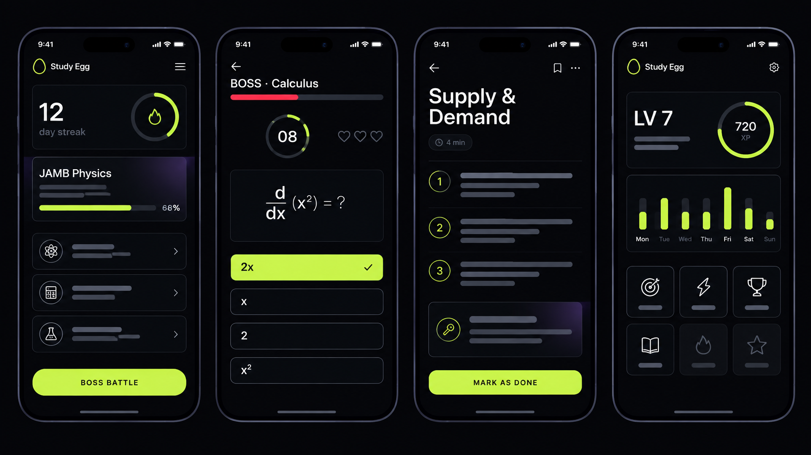

# Study Egg

Study Egg is a gamified learning app for ambitious 16 to 30 year olds. It covers exam prep (WAEC/NECO, JAMB, junior school), university courses, professional exams (ICAN, CIBN), career skills (virtual assistant, product management, content creation), more than twenty trades, and Hausa, Igbo and Yoruba. Learners practise with explanations after every answer, fight timed Boss Battles, read short mini-lessons, and climb from Rookie to Elite.

The whole app is one self-contained file, `index.html`. It works offline once loaded and can be added to an iPhone or Android home screen.



---

## Quick start

| I want to... | Do this |
|---|---|
| Publish it on the web | Follow [docs/GITHUB-SETUP.md](docs/GITHUB-SETUP.md) (about 10 minutes, free) |
| Try it on my iPhone today | Double-click `SERVE.bat`, then open the address it shows in Safari on your phone |
| Change something | Edit files in `src/`, double-click `BUILD.bat`, then commit and push |
| Learn where everything lives | Read [docs/MAINTENANCE-GUIDE.md](docs/MAINTENANCE-GUIDE.md) |

You need **Python 3** (free, python.org). **Node.js** (free, nodejs.org) is optional and adds a deeper error check and the automated tests.

---

## What is in this repository

```
index.html          The finished app. GitHub Pages publishes this file.
src/                The editable version, split into readable pieces
  index.html        Screen layouts
  css/styles.css    All styling (Midnight Focus and the phone layout are at the end)
  js/               One file per part of the app (see the guide for a map)
  manifest.json     Home-screen name and colours
  assets/           Home-screen icons
tools/
  build.py          Packs src/ into index.html
  check.py          Finds broken brackets, commas and incomplete questions
  split.py          Turns any single Study Egg file back into src/
  serve.py          Serves the app over Wi-Fi so you can test on your phone
tests/              Automated tests (node tests/app.test.js)
docs/               Setup and maintenance guides
design/             Mockups and the full-size app icon
BUILD.bat           Windows: build + check + test
SERVE.bat           Windows: test on your phone over Wi-Fi
PREVIEW.bat         Windows: open the editable version in your browser
build.sh, serve.sh  Mac and Linux versions
.github/workflows/  Runs the checks automatically every time you push
```

---

## The golden rules

1. **Edit `src/`, never `index.html` directly.** `index.html` is rebuilt from `src/` every time you run BUILD.
2. **Run BUILD before every commit.** GitHub checks that `index.html` matches `src/` and shows a red cross if it does not.
3. **Keep the same web address.** Learners' progress is saved on their own phones and tied to the address. Moving to a new address starts everyone from zero.
4. **Never rename the save key** `studyquest_v2` in `src/js/02-content.js`. It still uses the app's old internal name, and it is where everyone's progress lives.
5. **Never put secret keys in this app.** Anyone can read the code of a web page. Only public keys (Paystack `pk_live_...`, Supabase `anon`) belong here.

---

## Version

October 2026: Midnight Focus redesign. See [CHANGELOG.md](CHANGELOG.md).

Prepared by Chiamaka Nwabulue. All rights reserved.
